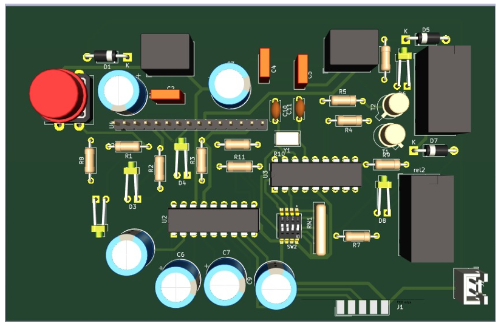
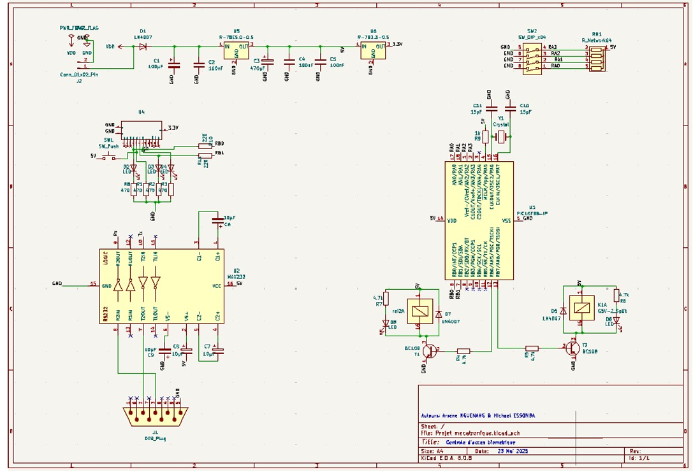
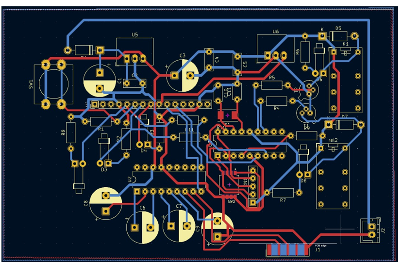
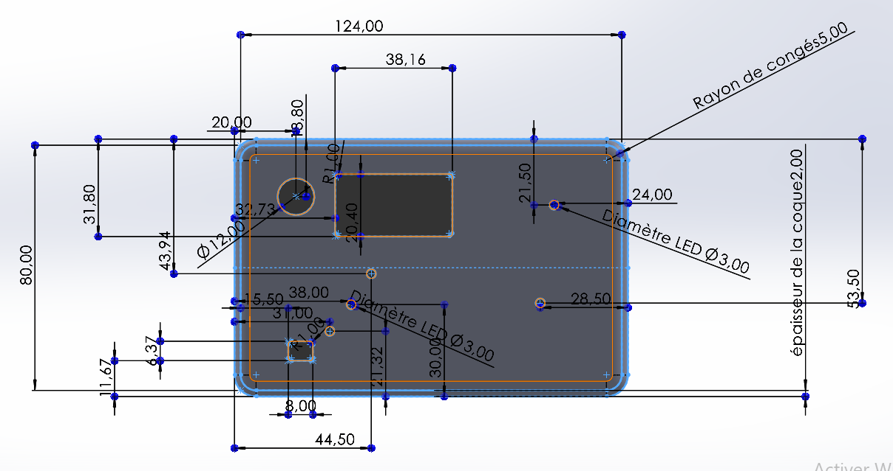
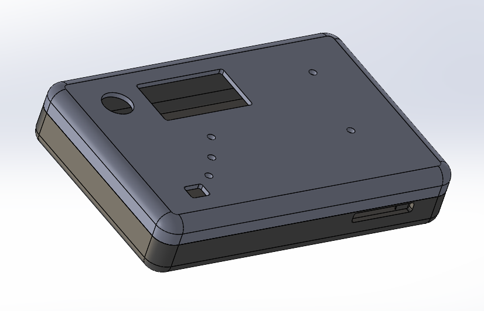
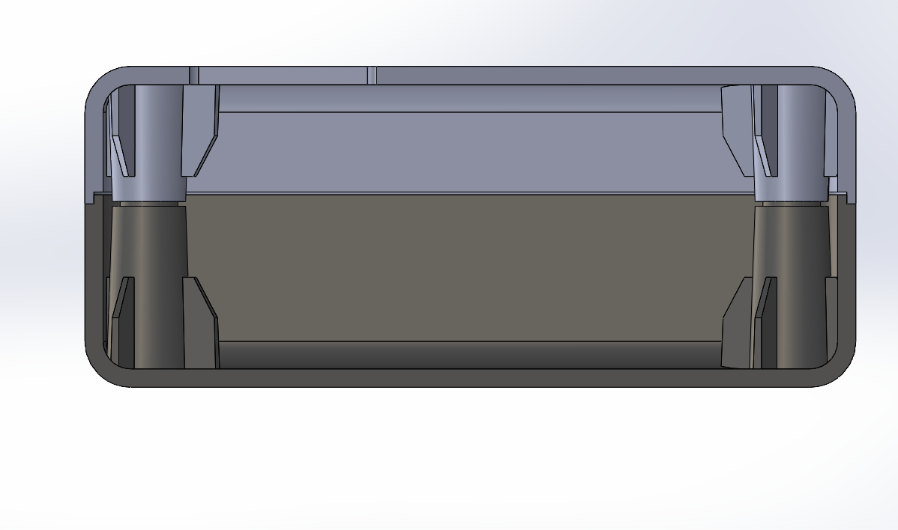

# PIC16 Biometric Access Control

<p align="center">
  <strong>Biometric access-control system combining embedded electronics, PCB design and parametric mechanical integration</strong><br>
  PIC16F88 · SFM3050-TC1 · MAX232 · RS232 · Relays · KiCad · SolidWorks
</p>

<p align="center">
  
</p>

<p align="center">
  <strong>Academic mechatronics project — ENSIM · Le Mans University · 2025</strong>
</p>

---

## Overview

This project focuses on the design of a **biometric access-control system** based on fingerprint authentication.

The system was designed around:

- a **SFM3050-TC1 fingerprint module**;
- a **PIC16F88 microcontroller**;
- a **MAX232 serial interface**;
- two electromechanical relays for access-control outputs;
- visual status indicators;
- a custom **KiCad PCB**;
- a dedicated **parametric SolidWorks enclosure**.

The project covers both the **electronic architecture** and the **mechanical integration** of the complete device.

> **Project status**
>
> The electronic schematic, PCB routing, 3D PCB validation and parametric enclosure were completed digitally.  
> The PCB was **not physically manufactured**, and the enclosure was **not 3D-printed / machined** before the end of the project.

---

## Project objectives

The system was designed to provide:

- fingerprint-based authentication;
- access-control output through relays;
- visual feedback using LEDs;
- configuration through a DIP switch and push button;
- serial communication between the fingerprint module and the controller;
- external RS232 connectivity;
- regulated 5 V and 3.3 V power rails;
- mechanical protection and ergonomic access to external components.

---

## Design targets

The original specification defined the following targets:

| Requirement | Target |
|---|---|
| Biometric sensor | SFM3050-TC1 |
| Fingerprint capacity | Up to 255 fingerprints |
| Sensor resolution | 508 dpi |
| Authentication time | < 1 s target |
| Main controller | PIC16F88 |
| MCU clock | 4 MHz quartz |
| Serial interface | RS232 |
| External power supply | 6 V / 500 mA |
| Logic supply | 5 V |
| Biometric-module supply | 3.3 V |
| User feedback | LEDs |
| Access output | 2 relays |

These values correspond to the **design requirements and selected component capabilities**, not to a completed physical validation campaign.

---

# 1. System architecture

The system is divided into five main functional blocks:

```text
Fingerprint module
      │
      │ Serial communication
      ▼
   MAX232
      │
      ▼
  PIC16F88
   │   │   │
   │   │   ├── DIP switch / push button
   │   │
   │   ├────── LEDs
   │
   └────────── Relay drivers
                  │
                  ▼
            Access-control load
```

The PIC16F88 acts as the central controller and is intended to:

- receive identification data from the biometric module;
- interpret the authentication result;
- control the relay outputs;
- manage LEDs and user inputs;
- supervise the overall access-control logic.

---

# 2. Electronic design

The complete electronic schematic was designed in **KiCad**.

<p align="center">
  
</p>

## Main electronic blocks

### SFM3050-TC1 biometric module

The fingerprint module provides:

- fingerprint acquisition;
- local biometric processing;
- internal fingerprint storage;
- serial communication;
- 3.3 V operation.

A custom KiCad symbol was created from the module documentation because the component was not available in the standard KiCad libraries.

### PIC16F88

The PIC16F88 is the main control element.

Its intended responsibilities are:

- serial data reception;
- authentication-result processing;
- relay control;
- LED control;
- DIP-switch and push-button management.

### MAX232

The MAX232 provides level conversion between the serial interface and RS232 voltage levels.

This allows communication between the biometric-control electronics and an external RS232 interface.

### Relay outputs

Two relays are included to control an external access device, such as:

- an electric lock;
- a door-opening mechanism;
- another low-voltage access-control load.

The relays are driven through transistor stages and protected with flyback diodes.

### Visual indicators

Multiple LEDs provide system-state feedback, for example:

```text
System ready
Authentication accepted
Authentication rejected
Relay / door state
```

---

# 3. Power architecture

The system is powered from an external **6 V / 500 mA supply**.

Two regulated rails are generated:

```text
6 V input
   │
   ├── 7805 ─────→ 5 V
   │               ├── PIC16F88
   │               └── MAX232
   │
   └── LE33 ─────→ 3.3 V
                   └── SFM3050-TC1
```

Decoupling and filtering capacitors were included around the regulators and active devices to improve supply stability.

---

# 4. PCB design

The PCB was routed in KiCad after assigning footprints to the complete schematic.

<p align="center">
  
</p>

## Placement strategy

The PCB layout was organized to:

- keep the biometric module accessible;
- place the power regulators near the supply input;
- keep the crystal close to the PIC16F88;
- separate relay power sections from sensitive logic;
- keep critical signal paths short;
- provide access to the DIP switch and push button;
- preserve clear routing around the serial interface.

Both front and back copper layers are used where necessary to complete routing while maintaining a compact design.

---

## 3D PCB validation

KiCad's 3D viewer was used to verify component placement and mechanical compatibility.

<p align="center">
  
</p>

This view was used to check:

- component orientation;
- component height and spacing;
- relay placement;
- connector access;
- switch accessibility;
- overall PCB / enclosure integration.

Additional external 3D models were associated with selected components to improve the mechanical representation.

---

# 5. Mechanical enclosure

A dedicated enclosure was designed in **SolidWorks 2024** to protect the electronics while keeping the user-facing elements accessible.

The enclosure is approximately:

```text
124 mm × 80 mm
```

and includes dedicated openings for:

- the SFM3050-TC1 fingerprint module;
- status LEDs;
- the push button;
- the DIP switch;
- the external power cable;
- external connectors.

---

## Parametric front design

The enclosure geometry was built from pilot sketches so that key dimensions could be modified without manually rebuilding the entire model.

<p align="center">
  
</p>

Important dimensions include:

- biometric sensor opening: approximately **38 mm × 31 mm**;
- LED openings;
- push-button opening;
- DIP-switch opening;
- enclosure wall thickness;
- corner radius;
- connector access.

---

## Isometric enclosure view

<p align="center">
  
</p>

The enclosure consists of upper and lower parts designed to fit together while maintaining access to the electronics and external interfaces.

---

# 6. Parametric mechanical design

The enclosure was developed using a master-sketch / equation-driven strategy.

The model includes:

- pilot sketches;
- extruded base geometry;
- shell operations;
- fillets;
- component cut-outs;
- assembly lip and groove;
- fixation bosses;
- repeated fastening features;
- equation-driven geometry.

This approach makes the design easier to adapt if the PCB dimensions or component positions change.

---

## Lip-and-groove assembly

The upper and lower enclosure sections use a **lip-and-groove interface** to improve positioning and assembly repeatability.

The design relationship follows the principle:

```text
groove thickness = shell thickness / 2 + assembly clearance
lip thickness    = shell thickness / 2
```

This creates a controlled mechanical clearance between both enclosure halves.

---

## Fixation bosses

Internal bosses were added to maintain mechanical alignment and provide stable fastening points.

Their dimensions and spacing are linked to the main enclosure geometry.

This means that when the master dimensions are changed, the fastening features update automatically.

---

# 7. Section-view validation

A section view was used to verify:

- alignment of the upper and lower enclosure sections;
- lip-and-groove engagement;
- internal clearance;
- fixation-boss alignment;
- absence of major geometric interference.

<p align="center">
  
</p>

---

# 8. Mechanical robustness test

The parametric model was also tested by modifying master dimensions such as:

- enclosure height;
- corner radius;
- shell-related dimensions.

The goal was to verify that:

- dependent geometry updated correctly;
- fastening bosses remained aligned;
- the enclosure remained assemblable;
- no major SolidWorks feature conflicts were introduced.

This validation showed that the model was sufficiently parameterized to support later design changes.

---

# 9. Electronic / mechanical integration

One of the main objectives of the project was not only to design a PCB, but to consider the PCB and enclosure as a single mechatronic system.

The integration process considered:

```text
Electronic requirements
        +
Component dimensions
        +
Connector accessibility
        +
User interaction
        +
Mechanical protection
        ↓
Integrated enclosure + PCB concept
```

Particular attention was given to:

- the fingerprint-reader opening;
- LED visibility;
- access to the push button and DIP switch;
- connector positioning;
- cable routing;
- PCB fastening;
- enclosure assembly.

---

# 10. Project validation status

| Item | Status |
|---|---|
| Functional requirements | ✅ Defined |
| Electronic architecture | ✅ Defined |
| KiCad schematic | ✅ Completed |
| Custom SFM3050 symbol | ✅ Completed |
| Footprint assignment | ✅ Completed |
| PCB routing | ✅ Completed |
| PCB 3D inspection | ✅ Completed |
| Parametric enclosure | ✅ Completed |
| Mechanical section checks | ✅ Completed |
| Parametric robustness tests | ✅ Completed |
| PCB manufacturing | ❌ Not completed |
| Physical enclosure fabrication | ❌ Not completed |
| Full physical system integration | ❌ Not completed |
| Firmware source in this repository | ❌ Not included |

The repository therefore documents a **complete electronic and mechanical design study**, rather than claiming a fabricated and experimentally validated final product.

---

# 11. Repository structure

```text
pic16-biometric-access-control/
│
├── README.md
├── .gitignore
│
├── assets/
│   └── images/
│       ├── pcb-3d-view.png
│       ├── pcb-layout.png
│       ├── schematic.png
│       ├── enclosure-front.png
│       ├── enclosure-isometric.png
│       └── enclosure-section.png
│
├── docs/
│   ├── electronics-report.pdf
│   └── mechanical-report.pdf
│
└── hardware/
    ├── electronics/
    │   ├── kicad/
    │   │   ├── biometric-access-control.kicad_pro
    │   │   ├── biometric-access-control.kicad_sch
    │   │   └── biometric-access-control.kicad_pcb
    │   │
    │   └── libraries/
    │       ├── symbols/
    │       │   └── SFM3050.kicad_sym
    │       ├── footprints/
    │       │   └── SW_DIP_x04.pretty/
    │       └── 3d-models/
    │
    └── mechanical/
        └── solidworks/
            └── Biometrique_Boitier.SLDASM
```

> SolidWorks part files should also be added under `hardware/mechanical/solidworks/` if the original `.SLDPRT` files are available.

---

# 12. Technologies

### Embedded / electronics

`PIC16F88` · `SFM3050-TC1` · `MAX232` · `RS232` · `Relays` · `LEDs`

### Electronic design

`KiCad` · `Schematic capture` · `PCB routing` · `Footprint assignment` · `3D PCB validation`

### Mechanical design

`SolidWorks 2024` · `Parametric CAD` · `Master sketches` · `Shell` · `Assembly features`

### Mechatronics

`Electronic / mechanical integration` · `Component accessibility` · `Enclosure design`

---

# 13. Engineering skills demonstrated

This project demonstrates experience with:

- electronic-system architecture;
- microcontroller-based system design;
- serial communication architecture;
- power-supply design;
- relay-driver design;
- schematic capture;
- custom KiCad symbols;
- PCB component placement;
- PCB routing;
- mechanical / electronic co-design;
- parametric SolidWorks modeling;
- tolerance and assembly considerations;
- technical documentation.

---

# 14. Documentation

The complete project documentation is available in:

### [Electronic design report](docs/electronics-report.pdf)

Covers:

- functional requirements;
- electronic architecture;
- PIC16F88;
- SFM3050-TC1;
- MAX232;
- relay outputs;
- power regulation;
- schematic design;
- custom biometric-module symbol;
- footprint assignment;
- PCB routing;
- 3D PCB inspection.

### [Mechanical design report](docs/mechanical-report.pdf)

Covers:

- enclosure requirements;
- pilot sketches;
- parametric modeling;
- upper and lower enclosure design;
- lip / groove assembly;
- fixation bosses;
- component openings;
- section-view validation;
- robustness tests.

---

# 15. Limitations and future work

The next steps required to transform this digital prototype into a complete physical system are:

1. **Manufacture the PCB**
   - produce Gerber files;
   - fabricate and assemble the board;
   - verify power rails and continuity.

2. **Develop / integrate firmware**
   - implement PIC16F88 serial communication;
   - interface the SFM3050-TC1;
   - implement authentication states;
   - drive LEDs and relays.

3. **Fabricate the enclosure**
   - 3D print or machine the housing;
   - validate clearances and connector accessibility;
   - test mechanical robustness.

4. **Perform complete system validation**
   - fingerprint enrollment;
   - successful / rejected authentication;
   - relay actuation;
   - long-term power and thermal testing.

5. **Improve user interaction**
   - optional buzzer;
   - richer status indication;
   - optional display or external supervision.

---

# Project outcome

This project resulted in a complete **digital mechatronic design** for a biometric access-control device combining:

- fingerprint-based access architecture;
- PIC16F88 control;
- RS232 interfacing;
- regulated power supplies;
- relay outputs;
- custom PCB design;
- 3D PCB validation;
- parametric enclosure design;
- mechanical integration studies.

Although the hardware was not fabricated, the project established a coherent architecture and validated the electronic and mechanical feasibility of the concept.

---

## Authors

**Michael Essomba**  
**Arsène Nguenang Youkap**

ENSIM — Le Mans University  
Academic year: **2024–2025**
